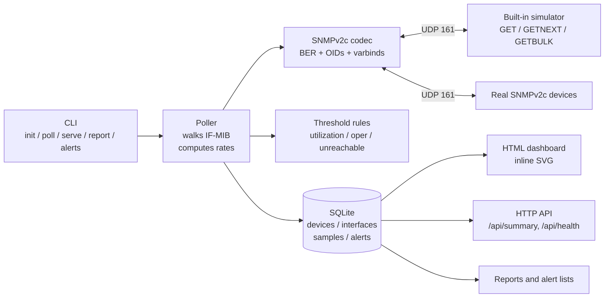

# snmp-netwatch

A zero-dependency SNMPv2c network monitor for small labs: it polls interface tables, computes rates and utilization, keeps history in SQLite, raises threshold alerts and renders a self-contained HTML dashboard.

[](https://github.com/jeremydacosta-TechOptimist/snmp-netwatch/actions/workflows/ci.yml)


Network monitoring usually starts with a package manager: an SNMP library, a collector, a time-series database and a dashboard server. For a small lab that is a lot of moving parts. This project takes the opposite route: one Python package with no runtime dependencies that speaks SNMPv2c itself. It walks the IF-MIB interface table of a switch or server, turns raw octet counters into bit rates and utilization, stores the history, evaluates alert rules, and serves a dashboard that is a single HTML file. A built-in agent simulator lets the whole flow run on localhost without hardware, which is also how the test suite exercises it.

## Features

- Hand-written BER/SNMPv2c codec: INTEGER, OCTET STRING, NULL, OBJECT IDENTIFIER, IpAddress, Counter32, Gauge32, TimeTicks, Counter64, SEQUENCE, GET/GETNEXT/GETBULK/RESPONSE, varbind lists, long-form lengths and v2c exception values.
- Built-in localhost SNMP agent simulator with a small interface MIB (`sysDescr`, `sysUpTime`, `sysName`, `ifNumber`, `ifIndex`, `ifDescr`, `ifAlias`, `ifOperStatus`, `ifSpeed`, `ifInOctets`, `ifOutOctets` and high-capacity counters) and smooth, monotonic counter growth.
- Poller that discovers interfaces with GETNEXT walks, prefers 64-bit `ifHCInOctets`/`ifHCOutOctets` when the agent has them, and handles 32-bit counter wrap when it does not.
- Interface rate and utilization computation from counter deltas, with the first poll of a device stored as counters only.
- SQLite history (devices, interfaces, samples, alerts) with schema creation, counter-reset handling and configurable sample retention.
- Threshold alerting for utilization percentage, operational status down and unreachable devices, with deduplication and automatic resolution.
- Self-contained HTML dashboard with inline CSS and inline SVG sparklines (no CDN, no external assets, no JavaScript), plus a standard-library HTTP server that exposes it at `/` with JSON at `/api/summary` and `/api/health`.
- `argparse` CLI with seven sub-commands and meaningful exit codes (0 success, 1 runtime failure, 2 bad usage).

## Quick start

```powershell
git clone https://github.com/jeremydacosta-TechOptimist/snmp-netwatch.git
cd snmp-netwatch
python -m pip install -e .
python -m netwatch --version
```

```text
netwatch 1.0.0
```

The console script `netwatch` and `python -m netwatch` are equivalent; the examples below use the module form so they also work from a source checkout with `$env:PYTHONPATH = "src"`.

No switch, agent or service is required for the first run: `poll --simulate` starts the built-in simulator on an ephemeral localhost port, polls it three times and stores the results.

```powershell
python -m netwatch poll --simulate --count 3 --interval 1
```

```text
simulator listening on udp://127.0.0.1:60253 (community: public)
simulated device: simsw01.example with 3 interfaces (1 Gigabit uplink, server, spare)
device simsw01.example (simulator) - reachable in 35 ms at 2026-11-16 17:08:28 UTC
  sysDescr : NetWatch simulated SNMPv2c agent, model NS-24, firmware 1.0
  sysUpTime: 0d 00:00:00
  INTERFACE      ALIAS               SPEED OPER                IN           OUT    UTIL
  Ethernet0/1    uplink-core     1.00 Gbps up                   -             -       -
  Ethernet0/2    server-farm     1.00 Gbps up                   -             -       -
  Ethernet0/3    spare          100.00 Mbps down                 -             -       -
  alert opened: Ethernet0/3 (spare): oper status is down (expected up)

device simsw01.example (simulator) - reachable in 34 ms at 2026-11-16 17:08:29 UTC
  sysDescr : NetWatch simulated SNMPv2c agent, model NS-24, firmware 1.0
  sysUpTime: 0d 00:00:01
  INTERFACE      ALIAS               SPEED OPER                IN           OUT    UTIL
  Ethernet0/1    uplink-core     1.00 Gbps up         183.10 Mbps   125.23 Mbps   18.3%
  Ethernet0/2    server-farm     1.00 Gbps up         389.03 Mbps   296.51 Mbps   38.9%
  Ethernet0/3    spare          100.00 Mbps down             0 bps         0 bps    0.0%

device simsw01.example (simulator) - reachable in 34 ms at 2026-11-16 17:08:30 UTC
  sysDescr : NetWatch simulated SNMPv2c agent, model NS-24, firmware 1.0
  sysUpTime: 0d 00:00:02
  INTERFACE      ALIAS               SPEED OPER                IN           OUT    UTIL
  Ethernet0/1    uplink-core     1.00 Gbps up         188.85 Mbps   127.63 Mbps   18.9%
  Ethernet0/2    server-farm     1.00 Gbps up         387.32 Mbps   289.40 Mbps   38.7%
  Ethernet0/3    spare          100.00 Mbps down             0 bps         0 bps    0.0%
3 poll(s) completed; 9 sample(s) stored; 1 active alert(s)
```

The first poll has no rates because there is no previous sample; the second and third compare counters against the stored sample. Against real hardware the same command is `netwatch poll --device 192.0.2.10` or `--device 192.0.2.10:1161` for a non-default port.

## Usage

### Report from stored history

```powershell
python -m netwatch report
```

```text
netwatch report - 2026-11-16 17:08:33 UTC
database  : netwatch.db
thresholds: utilization >= 80.0%, oper-down alerts=on, unreachable alerts=on

devices: 1 (1 reachable) | interfaces: 3 | samples: 9 | active alerts: 1

DEVICE                 NAME               STATUS       IFACES  LAST POLL
simulator              simsw01.example    reachable         3  2026-11-16 17:08:30 UTC

interfaces on simulator (simsw01.example)
  INTERFACE      ALIAS               SPEED OPER                IN           OUT    UTIL SAMPLES
  Ethernet0/1    uplink-core     1.00 Gbps up         188.85 Mbps   127.63 Mbps   18.9%       3
  Ethernet0/2    server-farm     1.00 Gbps up         387.32 Mbps   289.40 Mbps   38.7%       3
  Ethernet0/3    spare          100.00 Mbps down             0 bps         0 bps    0.0%       3

active alerts
  [critical] oper_status_down simsw01.example / Ethernet0/3 (spare) (2026-11-16 17:08:28 UTC) - Ethernet0/3 (spare): oper status is down (expected up)
```

### Active alerts

```powershell
python -m netwatch alerts
```

```text
  ID  CREATED               SEVERITY  KIND               TARGET                                   MESSAGE
   1  2026-11-16 17:08:28 UTC critical  oper_status_down   simsw01.example / Ethernet0/3 (spare)    Ethernet0/3 (spare): oper status is down (expected up)

1 active alert(s), 0 resolved alert(s) in total
```

`netwatch alerts --all` includes resolved events and adds a STATE column; `--json` returns the same data as JSON.

### Dashboard and HTTP API

`python -m netwatch dashboard --output dashboard.html` writes a complete single-file dashboard (captured: `dashboard written to dashboard.html (5547 bytes)`), and a rendered example from the demo data is committed at [examples/dashboard.html](examples/dashboard.html). For a live view, start the server; it re-reads SQLite on every request:

```powershell
python -m netwatch serve --port 8080
```

```text
netwatch dashboard listening on http://127.0.0.1:8080/
```

```powershell
curl.exe -s http://127.0.0.1:8080/api/health
```

```json
{
  "status": "ok",
  "generated_at": "2026-11-16T17:08:42+00:00",
  "samples": 9,
  "active_alerts": 1
}
```

`GET /api/summary` returns totals, thresholds, per-interface latest rates and active alerts in the same shape used by `report --json`. Exit codes: `0` success, `1` runtime failure (for example an unreachable device), `2` bad usage (for example a missing target or `--count 0`).

## Architecture



The CLI opens the SQLite store and hands a device endpoint to the poller. The poller sends one GET for the system group and then walks the IF-MIB columns with GETNEXT, using the codec and the synchronous UDP client. Counter snapshots are compared with the previous stored sample to compute inbound/outbound bit rates and utilization, then written to `samples`; threshold rules read the same readings, open or resolve `alerts` rows and update device reachability. The dashboard and HTTP API are read-only projections of the database, so a poll running in another terminal appears on the next refresh without restarting anything. Because the simulator speaks the same wire protocol as a real agent, the tests exercise the complete pipeline offline on localhost.

## Project layout

```text
snmp-netwatch/
├── .github/workflows/ci.yml     # test matrix: Python 3.10 to 3.13
├── .gitignore
├── LICENSE
├── README.md
├── pyproject.toml
├── examples/
│   └── dashboard.html           # rendered from the demo data
├── src/netwatch/
│   ├── __init__.py
│   ├── __main__.py             # python -m netwatch
│   ├── ber.py                  # BER encoder/decoder
│   ├── oid.py                  # OBJECT IDENTIFIER parsing and ordering
│   ├── snmp.py                 # SNMPv2c messages, varbind types, UDP client
│   ├── mib.py                  # SNMPv2-MIB / IF-MIB object identifiers
│   ├── agent.py                # localhost agent simulator
│   ├── poller.py               # walks, rates, utilization, alert wiring
│   ├── storage.py              # SQLite schema and queries
│   ├── alerting.py             # threshold rules
│   ├── dashboard.py            # self-contained HTML and SVG sparklines
│   ├── server.py               # stdlib HTTP server and JSON API
│   ├── reporting.py            # report/alert text and JSON summaries
│   ├── formatting.py           # rate, speed, utilization formatting
│   ├── clock.py                # system and fixed clocks
│   └── cli.py                  # argparse sub-commands
└── tests/
    ├── helpers.py
    ├── test_agent.py           # UDP GET/GETNEXT/GETBULK against the simulator
    ├── test_alerting.py        # threshold rule decisions
    ├── test_ber.py             # length forms, INTEGER, TLV, malformed input
    ├── test_cli.py             # CLI end-to-end via subprocess
    ├── test_dashboard.py       # HTML markers, escaping, sparkline geometry
    ├── test_integration.py     # agent, poller, store, alerts, dashboard
    ├── test_oid.py             # parsing, ordering, prefix helpers
    ├── test_poller.py          # counter deltas, wrap, rates, unreachable handling
    ├── test_reporting.py       # text reports and JSON summaries
    ├── test_server.py          # dashboard and JSON endpoints over localhost HTTP
    ├── test_snmp.py            # message/varbind round-trips and validation
    └── test_storage.py         # schema, persistence, alerts, retention
```

## Testing

The suite uses `unittest.TestCase` classes only, so both runners work. No test touches the internet; the simulator binds `127.0.0.1:0` and SQLite databases live in `tempfile.TemporaryDirectory`. Clocks are injected, so counter rates and timestamps are deterministic.

```powershell
# from the repository root
$env:PYTHONPATH = "src"
py -3.13 -m pytest -q
python -m unittest discover -s tests -v
python -m compileall -q src tests
```

Captured with pytest 9.0.3 on Python 3.13 and unittest on Python 3.11:

```text
218 passed, 63 subtests passed in 19.15s
```

```text
Ran 218 tests in 19.405s

OK
```

Coverage includes BER round-trips and malformed packets, SNMPv2c message encode/decode, real UDP GET/GETNEXT/GETBULK exchanges against the simulator, GETNEXT walks, 32-bit counter wrap, 64-bit counter resets, rate and utilization math, SQLite persistence and retention, alert lifecycle and deduplication, HTML escaping and SVG geometry, the HTTP endpoints, and the CLI end-to-end through `subprocess`. CI runs the suite on Python 3.10, 3.11, 3.12 and 3.13.

## Roadmap

- SNMPv3 (USM authentication and privacy) behind the existing client interface, keeping SNMPv2c as the default.
- Device inventory and thresholds from a configuration file instead of per-command flags.
- Additional MIB groups (HOST-RESOURCES-MIB CPU and memory, entity inventory) and long-term sample rollups.

## Resumo em português (PT-PT)

- Monitor SNMPv2c sem dependências externas: o protocolo é implementado à mão em Python, desde a codificação BER até às mensagens GET, GETNEXT e GETBULK.
- Inclui um agente simulador local, pelo que `poll --simulate` demonstra todo o fluxo sem qualquer equipamento de rede.
- Guarda o histórico de interfaces em SQLite, calcula taxas e utilização a partir de contadores e aplica regras de alerta para utilização elevada, interface em baixo e equipamento inacessível.
- O painel HTML é autónomo (CSS e SVG embutidos, sem CDN) e pode ser servido por um servidor HTTP da biblioteca padrão com API JSON em `/api/summary` e `/api/health`.
- O CLI tem subcomandos `init`, `poll`, `dashboard`, `report`, `alerts`, `serve` e `agent`, com códigos de saída 0, 1 e 2.

## License

MIT © 2026 Jeremy da Costa. See [LICENSE](LICENSE).
